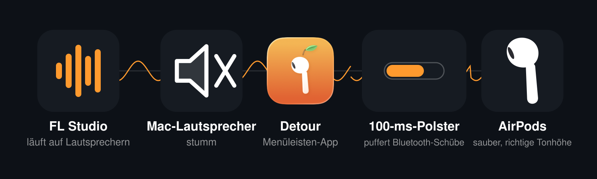
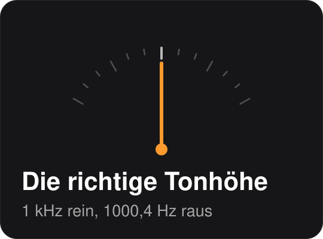

<picture>
  <source media="(prefers-color-scheme: light)" srcset="docs/assets/hero-light-de.svg">
  
</picture>

<p align="center">
  
</p>

<p align="center">
  <b>AirPods mit FL Studio auf dem Mac, ohne Knistern.</b><br>
  Eine kleine Menüleisten-App, die den Ton von FL Studio in deinen Bluetooth-Kopfhörern abspielt, in der richtigen Tonhöhe und ohne Klicks.
</p>

<p align="center">
  <a href="https://github.com/adrbn/detour/releases/latest"></a>
  &nbsp;
  <a href="#so-funktioniert-es"></a>
  &nbsp;
  <a href="https://github.com/adrbn/detour/issues/new"></a>
</p>

<p align="center">
  
  
  <a href="https://github.com/adrbn/detour/releases/latest"></a>
  
  <a href="./LICENSE"></a>
</p>

<p align="center">
  Kostenlos und Open Source · signiert und notarisiert · macOS 14.2 oder neuer auf Apple silicon<br>
  <a href="README.md">English</a> · <a href="README.fr.md">Français</a> · <a href="README.es.md">Español</a> · <b>Deutsch</b> · <a href="README.it.md">Italiano</a> · <a href="README.pt-BR.md">Português</a> · <a href="README.ja.md">日本語</a> · <a href="README.ko.md">한국어</a> · <a href="README.zh-Hans.md">简体中文</a> · <a href="README.ru.md">Русский</a>
</p>

---

## Das Problem

Du öffnest FL Studio auf deinem Mac, setzt deine AirPods ein, und dein Projekt klingt falsch:

- **Knistern und Klicks** im ganzen Mix, sogar bei einem einzelnen Sample;
- **leicht verstimmte Noten**: Die Tonhöhe stimmt nicht und schwankt manchmal;
- dasselbe Projekt klingt **auf den MacBook-Lautsprechern einwandfrei**.

Die üblichen Tipps helfen nicht. Wir haben jeden ausprobiert: einen größeren Buffer, 48 kHz, den Eingang auf „none“, eine Gerätesammlung (Aggregate Device), andere Audioeinstellungen in FL. Der Ton bleibt kaputt, weil das Problem keine Einstellung ist. Wenn die Ausgabe von FL Studio ein Paar AirPods ist, berechnet FL sein Audio schlecht, und AirPods holen sich den Ton in unregelmäßigen Schüben, die alles erbt, was ihrer Clock folgt.

Eine Falle macht es noch schlimmer. Die Ausgabe **„Default audio device“** von FL Studio folgt dem Standardgerät des Mac, also wechselt FL jedes Mal auf deine AirPods, wenn sie sich verbinden, selbst nachdem du es auf die Lautsprecher gestellt hast.

## Die Lösung

Detour lässt FL Studio auf den Mac-Lautsprechern, wo es richtig klingt, schaltet die Lautsprecher stumm und schickt denselben Ton an deine AirPods, in der richtigen Tonhöhe und ohne Klicks. Du hörst dein Projekt in deinen Kopfhörern so, wie es wirklich klingt, und in FL Studio ändert sich nichts.

> Detour ist zum Hören, Komponieren und Mixen gedacht. Bluetooth verzögert immer etwas, deshalb sind zum Aufnehmen von Gesang oder zum Einspielen im Timing kabelgebundene Kopfhörer weiterhin das richtige Werkzeug.

## Was Detour macht

<table>
  <tr>
    <td></td>
    <td></td>
    <td></td>
  </tr>
  <tr>
    <td></td>
    <td></td>
    <td></td>
  </tr>
</table>

## Funktionen

**Ton**
- Sauberer Ton aus FL Studio in den AirPods: kein Knistern, keine Klicks, richtige Tonhöhe.
- Detour liest FL Studio auf der gleichmäßigen Clock der Lautsprecher und speist die AirPods aus einem Polster von 100 ms, sodass ihr ungleichmäßiges Bluetooth-Timing nie deine Musik erreicht.
- Die Mac-Lautsprecher bleiben die ganze Zeit stumm, auch wenn deine AirPods nicht in den Ohren sind.

**Im Alltag**
- Nimm deine AirPods raus und setz sie wieder ein: Der Ton kommt innerhalb einer Sekunde von selbst zurück.
- Fängt an zu senden, sobald FL Studio spielt, und wartet still, wenn nicht.
- Warnt dich, wenn FL Studio selbst auf die AirPods gewechselt ist (seine Einstellung „Default audio device“ folgt ihnen), und sagt dir, was du ändern musst.
- Lebt in der Menüleiste. Kein Fenster, kein Symbol im Dock.

**Auswahl**
- Standardmäßig FL Studio; jede andere App, die Ton abspielt, lässt sich im Menü auswählen.
- Jede Bluetooth-Ausgabe: die erste verbundene oder eine, die du auswählst.

## Loslegen

1. **[Lade Detour herunter](https://github.com/adrbn/detour/releases/latest)**, öffne die `.dmg` und zieh Detour in „Programme“.
2. Öffne in FL Studio **Options › Audio settings** und stell **Output** auf die Lautsprecher deines Mac (zum Beispiel *MacBook Pro-Lautsprecher*). Nicht „Default audio device“: Das folgt deinen AirPods.
3. Öffne Detour. Wenn macOS fragt, erlaube es unter **Systemeinstellungen › Datenschutz & Sicherheit › Aufnahme von Bildschirm & Systemaudio**.
4. Setz deine AirPods ein und starte die Wiedergabe in FL Studio.

Das Kopfhörersymbol in der Menüleiste zeigt eine kleine Uhr, während Detour wartet, und ein Warnzeichen, wenn etwas deine Aufmerksamkeit braucht. Ohne Zusatz heißt es, dass der Ton an deine AirPods geht.

## So funktioniert es

FL Studio rendert auf den Mac-Lautsprechern sauber und schlecht, wenn seine Ausgabe ein Paar AirPods ist. Wir haben gemessen, warum die naheliegenden Lösungen scheitern: AirPods holen sich Audio in unregelmäßigen Schüben (zwischen 48.128 und 50.688 Samples von einer Sekunde zur nächsten, wo ein gleichmäßiges Gerät 48.000 nimmt), und alles, was ihrer Clock folgt, erbt das Schwanken.

Deshalb lässt Detour die AirPods nie das Tempo vorgeben:

1. Ein **Process Tap** (macOS 14.2+) greift die Ausgabe von FL Studio ab und schaltet sie auf den Lautsprechern stumm.
2. Der Tap wird auf der **Clock der Lautsprecher** gelesen, derselben, auf der FL Studio rendert.
3. Der Ton kommt in ein **Polster von 100 ms**. Die AirPods lesen in ihrem eigenen Tempo daraus, und eine sehr langsame Korrektur (höchstens 0,5 %, gemittelt über mehrere Sekunden) hält den Füllstand des Polsters. Das liegt weit unter dem, was ein Ohr als Änderung der Tonhöhe hören kann.

Ein 1-kHz-Testton durch die ganze Kette kommt ohne einen einzigen Klick und mit einer Tonhöhe von 1000,4 Hz heraus.

## FAQ

**Funktioniert es mit Ableton Live, Logic oder anderen Apps?**
Wähl die App im Detour-Menü aus. Bisher ist nur FL Studio 2026 getestet; Berichte zu anderen Apps sind in den Issues willkommen.

**Andere Bluetooth-Kopfhörer?**
Detour funktioniert mit jeder Bluetooth-Ausgabe. Getestet wurde es mit AirPods Pro 2.

**Wie viel Verzögerung kommt dazu?**
Etwa eine Zehntelsekunde zusätzlich zur Bluetooth-Verzögerung der AirPods. Gut zum Hören und Mixen, nicht zum Aufnehmen im Timing.

**Nimmt es etwas auf?**
Nein. Das Audio geht im Arbeitsspeicher vom Tap zu den Kopfhörern und wird nie gespeichert. Detour stellt keine Netzwerkanfragen.

## Voraussetzungen

- macOS 14.2 Sonoma oder neuer (Process Taps)
- Ein Mac mit Apple silicon
- Bluetooth-Kopfhörer

## Aus dem Quellcode bauen

```bash
git clone https://github.com/adrbn/detour.git
cd detour
swift test
./scripts/build.sh            # baut und signiert build/Detour.app
```

`NOTARY_PROFILE=<profil> ./scripts/build.sh` notarisiert die App außerdem und erstellt die `.dmg`. Die Grafiken der README erzeugt `python3 docs/assets/make_svgs.py`.

## Unterstützen

Detour ist kostenlos. Wenn es deine Sessions rettet, kannst du mir einen Kaffee spendieren.

<p>
  <a href="https://ko-fi.com/adrbn"></a>
</p>

## Lizenz

MIT: Nutze es, ändere es, teile es, behalte den Copyright-Hinweis.

<sub>Detour ist weder mit Image-Line noch mit Apple verbunden. FL Studio ist eine Marke von Image-Line Software; AirPods und macOS sind Marken von Apple Inc.</sub>
