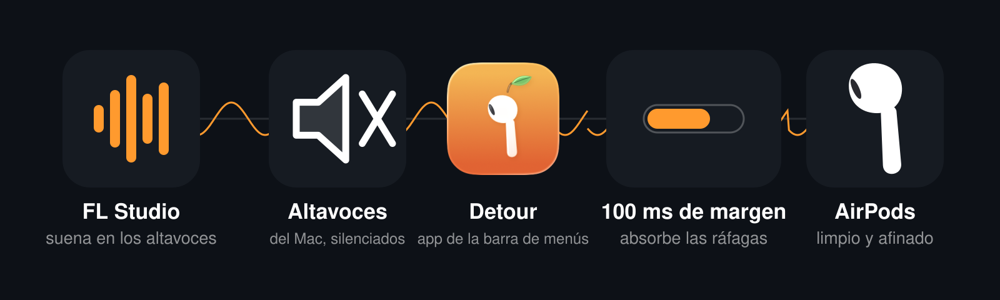
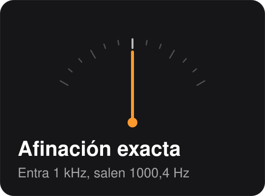

<picture>
  <source media="(prefers-color-scheme: light)" srcset="docs/assets/hero-light-es.svg">
  
</picture>

<p align="center">
  
</p>

<p align="center">
  <b>AirPods con FL Studio en el Mac, sin crujidos.</b><br>
  Una pequeña app de la barra de menús que reproduce el sonido de FL Studio en tus auriculares Bluetooth con la afinación correcta y sin clics.
</p>

<p align="center">
  <a href="https://github.com/adrbn/detour/releases/latest"></a>
  &nbsp;
  <a href="#cómo-funciona"></a>
  &nbsp;
  <a href="https://github.com/adrbn/detour/issues/new"></a>
</p>

<p align="center">
  
  
  <a href="https://github.com/adrbn/detour/releases/latest"></a>
  
  <a href="./LICENSE"></a>
</p>

<p align="center">
  Gratis y de código abierto · firmado y notarizado · macOS 14.2 o posterior en Apple silicon<br>
  <a href="README.md">English</a> · <a href="README.fr.md">Français</a> · <b>Español</b> · <a href="README.de.md">Deutsch</a> · <a href="README.it.md">Italiano</a> · <a href="README.pt-BR.md">Português</a> · <a href="README.ja.md">日本語</a> · <a href="README.ko.md">한국어</a> · <a href="README.zh-Hans.md">简体中文</a> · <a href="README.ru.md">Русский</a>
</p>

---

## El problema

Abres FL Studio en tu Mac, te pones los AirPods y tu proyecto suena mal:

- **crujidos y clics** por toda la mezcla, incluso con un solo sample;
- **notas un poco desafinadas**: la afinación se desvía y a veces oscila;
- el mismo proyecto suena **perfecto en los altavoces del MacBook**.

Las soluciones habituales no sirven. Las probamos una a una: un buffer más grande, 48 kHz, la entrada en “none”, un dispositivo agregado, otros ajustes de audio de FL. El sonido sigue roto, porque el problema no es un ajuste. Cuando la salida de FL Studio es un par de AirPods, renderiza mal el audio, y los AirPods piden el audio a ráfagas irregulares que se transmiten a todo lo que sigue su reloj.

Hay una trampa que lo empeora. La salida **“Default audio device”** de FL Studio sigue a la salida predeterminada del Mac, así que FL cambia a tus AirPods cada vez que se conectan, aunque lo hayas puesto en los altavoces.

## La solución

Detour deja FL Studio en los altavoces del Mac, donde suena bien, silencia los altavoces y envía ese mismo sonido a tus AirPods con la afinación correcta y sin clics. Oyes tu proyecto tal como suena de verdad, en tus auriculares, sin cambiar nada en FL Studio.

> Detour sirve para escuchar, componer y mezclar. El Bluetooth siempre añade retardo, así que para grabar voces o tocar a tiempo, unos auriculares con cable siguen siendo la herramienta adecuada.

## Qué hace

<table>
  <tr>
    <td></td>
    <td></td>
    <td></td>
  </tr>
  <tr>
    <td></td>
    <td></td>
    <td></td>
  </tr>
</table>

## Funciones

**Sonido**
- Audio limpio en los AirPods desde FL Studio: sin crujidos, sin clics, con la afinación correcta.
- Detour lee FL Studio con el reloj estable de los altavoces y alimenta los AirPods desde un margen de 100 ms, así que el ritmo irregular de su Bluetooth nunca llega a tu música.
- Los altavoces del Mac siguen en silencio todo el tiempo, también mientras tienes los AirPods fuera.

**Uso diario**
- Quítate los AirPods y vuelve a ponértelos: el sonido vuelve solo en menos de un segundo.
- Empieza a enviar en cuanto FL Studio reproduce algo, y espera en silencio cuando no.
- Te avisa cuando el propio FL Studio ha cambiado a los AirPods (su ajuste “Default audio device” los sigue) y te dice qué cambiar.
- Vive en la barra de menús. Sin ventana, sin icono en el Dock.

**Elección**
- FL Studio por defecto; cualquier otra app que reproduzca sonido se puede elegir en el menú.
- Cualquier salida Bluetooth: la primera conectada o la que tú elijas.

## Primeros pasos

1. **[Descarga Detour](https://github.com/adrbn/detour/releases/latest)**, abre el `.dmg` y arrastra Detour a Aplicaciones.
2. En FL Studio, abre **Options › Audio settings** y pon **Output** en los altavoces del Mac (por ejemplo, *Altavoces del MacBook Pro*). No “Default audio device”: ese sigue a tus AirPods.
3. Abre Detour. Cuando macOS lo pida, permítelo en **Ajustes del Sistema › Privacidad y seguridad › Grabación de pantalla y del audio del sistema**.
4. Ponte los AirPods y dale a reproducir en FL Studio.

Los auriculares de la barra de menús muestran un pequeño reloj mientras Detour espera y una señal de aviso cuando algo necesita tu atención. Si se ven los auriculares solos, el sonido va a tus AirPods.

## Cómo funciona

FL Studio renderiza limpio en los altavoces del Mac y mal cuando su salida es un par de AirPods. Medimos por qué fallan las soluciones obvias: los AirPods piden el audio a ráfagas irregulares (entre 48.128 y 50.688 muestras de un segundo a otro, cuando un dispositivo estable toma 48.000), y todo lo que sigue su reloj hereda esa oscilación.

Por eso Detour nunca deja que los AirPods marquen el ritmo:

1. Un **process tap** (macOS 14.2+) captura la salida de FL Studio y la silencia en los altavoces.
2. El tap se lee con el **reloj de los altavoces**, el mismo con el que renderiza FL Studio.
3. El sonido entra en un **margen de 100 ms**. Los AirPods leen de él a su propio ritmo, y una corrección muy lenta (como mucho un 0,5 %, promediada durante varios segundos) mantiene estable el nivel del margen. Está muy por debajo de lo que un oído percibe como un cambio de afinación.

Un tono de prueba de 1 kHz que atraviesa toda la cadena sale sin ningún clic y a 1000,4 Hz.

## Preguntas frecuentes

**¿Funciona con Ableton Live, Logic u otras apps?**
Elige la app en el menú de Detour. Por ahora solo se ha probado FL Studio 2026; los informes sobre otras apps son bienvenidos en las issues.

**¿Otros auriculares Bluetooth?**
Detour funciona con cualquier salida Bluetooth. Se ha probado con unos AirPods Pro 2.

**¿Cuánto retardo añade?**
Alrededor de una décima de segundo, además del retardo Bluetooth propio de los AirPods. Va bien para escuchar y mezclar, no para grabar a tiempo.

**¿Graba algo?**
No. El audio va del tap a los auriculares en memoria y nunca se guarda. Detour no hace ninguna petición de red.

## Requisitos

- macOS 14.2 Sonoma o posterior (process taps)
- Un Mac con Apple silicon
- Auriculares Bluetooth

## Compilar desde el código fuente

```bash
git clone https://github.com/adrbn/detour.git
cd detour
swift test
./scripts/build.sh            # compila y firma build/Detour.app
```

`NOTARY_PROFILE=<perfil> ./scripts/build.sh` también notariza la app y crea el `.dmg`. Las imágenes del README se generan con `python3 docs/assets/make_svgs.py`.

## Apoyo

Detour es gratis. Si te salva las sesiones, puedes invitarme a un café.

<p>
  <a href="https://ko-fi.com/adrbn"></a>
</p>

## Licencia

MIT: úsalo, modifícalo, compártelo y conserva el aviso de copyright.

<sub>Detour no está afiliado a Image-Line ni a Apple. FL Studio es una marca comercial de Image-Line Software; AirPods y macOS son marcas comerciales de Apple Inc.</sub>
