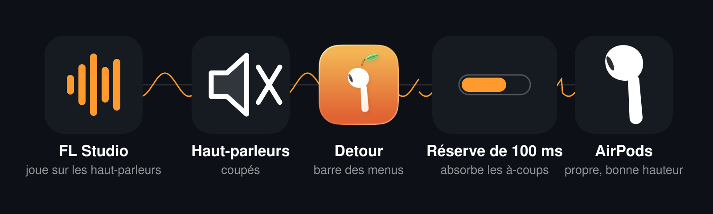
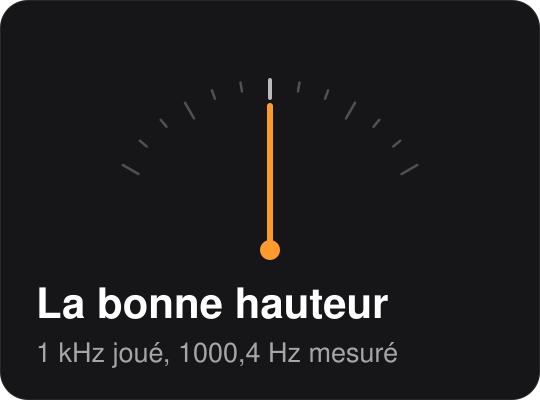

<picture>
  <source media="(prefers-color-scheme: light)" srcset="docs/assets/hero-light-fr.svg">
  
</picture>

<p align="center">
  
</p>

<p align="center">
  <b>Des AirPods avec FL Studio sur Mac, sans les craquements.</b><br>
  Une petite app de barre des menus qui joue le son de FL Studio dans vos écouteurs Bluetooth, à la bonne hauteur et sans clics.
</p>

<p align="center">
  <a href="https://github.com/adrbn/detour/releases/latest"></a>
  &nbsp;
  <a href="#comment-ça-marche"></a>
  &nbsp;
  <a href="https://github.com/adrbn/detour/issues/new"></a>
</p>

<p align="center">
  
  
  <a href="https://github.com/adrbn/detour/releases/latest"></a>
  
  <a href="./LICENSE"></a>
</p>

<p align="center">
  Gratuit et open source · signé et notarisé · macOS 14.2 ou plus récent sur Apple silicon<br>
  <a href="README.md">English</a> · <b>Français</b>
</p>

---

## Le problème

Vous ouvrez FL Studio sur votre Mac, vous mettez vos AirPods, et votre projet sonne faux :

- des **craquements et des clics** partout dans le mix, même sur un seul sample ;
- des **notes un peu fausses** : la hauteur est décalée, parfois elle ondule ;
- le même projet sonne **parfaitement sur les haut-parleurs du MacBook**.

Les solutions habituelles n'y changent rien. Nous les avons toutes essayées : un buffer plus grand, 48 kHz, l'entrée sur « none », un périphérique agrégé, d'autres réglages audio de FL. Le son reste abîmé, parce que le problème n'est pas un réglage. Quand la sortie de FL Studio est une paire d'AirPods, il calcule mal son audio, et les AirPods tirent le son par à-coups irréguliers dont hérite tout ce qui suit leur horloge.

Un piège aggrave les choses : la sortie **« Default audio device »** de FL Studio suit celle du Mac, donc FL repasse sur vos AirPods à chaque connexion, même après l'avoir réglé sur les haut-parleurs.

## La solution

Detour laisse FL Studio sur les haut-parleurs du Mac, où il sonne juste, coupe les haut-parleurs et envoie le même son dans vos AirPods, à la bonne hauteur et sans clics. Vous entendez votre projet tel qu'il sonne vraiment, dans vos écouteurs, sans rien changer dans FL Studio.

> Detour sert à écouter, composer et mixer. Le Bluetooth ajoute toujours un délai : pour enregistrer une voix ou jouer en rythme, un casque filaire reste le bon outil.

## Ce que fait Detour

<table>
  <tr>
    <td></td>
    <td></td>
    <td></td>
  </tr>
  <tr>
    <td></td>
    <td></td>
    <td></td>
  </tr>
</table>

## Fonctions

**Son**
- Un son propre dans les AirPods depuis FL Studio : pas de craquements, pas de clics, la bonne hauteur.
- Detour lit FL Studio sur l'horloge régulière des haut-parleurs et alimente les AirPods depuis une réserve de 100 ms : leur rythme Bluetooth irrégulier n'atteint jamais votre musique.
- Les haut-parleurs du Mac restent muets tout du long, même AirPods retirés.

**Au quotidien**
- Retirez vos AirPods et remettez-les : le son revient tout seul en moins d'une seconde.
- Commence à envoyer dès que FL Studio joue, et attend sans bruit sinon.
- Vous prévient quand FL Studio est lui-même passé sur les AirPods (son réglage « Default audio device » les suit) et vous dit quoi changer.
- Vit dans la barre des menus. Pas de fenêtre, pas d'icône dans le Dock.

**Choix**
- FL Studio par défaut ; toute autre app qui joue du son se choisit dans le menu.
- N'importe quelle sortie Bluetooth : la première connectée, ou celle que vous choisissez.

## Démarrer

1. **[Téléchargez Detour](https://github.com/adrbn/detour/releases/latest)**, ouvrez le `.dmg` et glissez Detour dans Applications.
2. Dans FL Studio, ouvrez **Options › Audio settings** et réglez **Output** sur les haut-parleurs du Mac (par exemple *Haut-parleurs MacBook Pro*). Pas « Default audio device » : celui-là suit vos AirPods.
3. Ouvrez Detour. Quand macOS le demande, autorisez-le dans **Réglages Système › Confidentialité et sécurité › Enregistrement de l'écran et de l'audio du système**.
4. Mettez vos AirPods et lancez la lecture dans FL Studio.

Le casque de la barre des menus porte une petite horloge quand Detour attend et une marque d'alerte quand il a besoin de vous. Un casque seul signifie que le son part vers vos AirPods.

## Comment ça marche

FL Studio rend un son propre sur les haut-parleurs du Mac et un son abîmé quand sa sortie est une paire d'AirPods. Nous avons mesuré pourquoi les corrections évidentes échouent : les AirPods tirent l'audio par à-coups irréguliers (entre 48 128 et 50 688 échantillons d'une seconde à l'autre, là où un appareil régulier en prend 48 000), et tout ce qui suit leur horloge hérite de ces à-coups.

Detour ne laisse donc jamais les AirPods donner le rythme :

1. Un **process tap** (macOS 14.2+) capte la sortie de FL Studio et la coupe sur les haut-parleurs.
2. Le tap est lu sur **l'horloge des haut-parleurs**, celle sur laquelle FL Studio calcule son rendu.
3. Le son passe dans une **réserve de 100 ms**. Les AirPods y puisent à leur rythme, et une correction très lente (0,5 % au plus, moyennée sur plusieurs secondes) garde la réserve à niveau. C'est bien en dessous de ce qu'une oreille entend comme un changement de hauteur.

Un son test à 1 kHz traversant toute la chaîne ressort sans aucun clic, à 1000,4 Hz.

## FAQ

**Ça marche avec Ableton Live, Logic ou d'autres apps ?**
Choisissez l'app dans le menu de Detour. Seul FL Studio 2026 a été testé pour l'instant ; vos retours sur d'autres apps sont bienvenus dans les issues.

**D'autres écouteurs Bluetooth ?**
Detour fonctionne avec toute sortie Bluetooth. Il a été testé avec des AirPods Pro 2.

**Quel délai ajoute-t-il ?**
Environ un dixième de seconde en plus du délai Bluetooth des AirPods. Très bien pour écouter et mixer, pas pour enregistrer en rythme.

**Est-ce que ça enregistre quelque chose ?**
Non. L'audio va du tap aux écouteurs en mémoire et n'est jamais sauvegardé. Detour ne fait aucune requête réseau.

## Configuration requise

- macOS 14.2 Sonoma ou plus récent (process taps)
- Un Mac avec Apple silicon
- Des écouteurs Bluetooth

## Compiler depuis les sources

```bash
git clone https://github.com/adrbn/detour.git
cd detour
swift test
./scripts/build.sh            # compile et signe build/Detour.app
```

`NOTARY_PROFILE=<profil> ./scripts/build.sh` notarise aussi l'app et fabrique le `.dmg`. Les visuels du README sont générés par `python3 docs/assets/make_svgs.py`.

## Soutenir

Detour est gratuit. S'il sauve vos sessions, vous pouvez m'offrir un café.

<p>
  <a href="https://ko-fi.com/adrbn"></a>
</p>

## Licence

MIT : utilisez-le, modifiez-le, partagez-le, en gardant la mention de copyright.

<sub>Detour n'est affilié ni à Image-Line ni à Apple. FL Studio est une marque d'Image-Line Software ; AirPods et macOS sont des marques d'Apple Inc.</sub>
