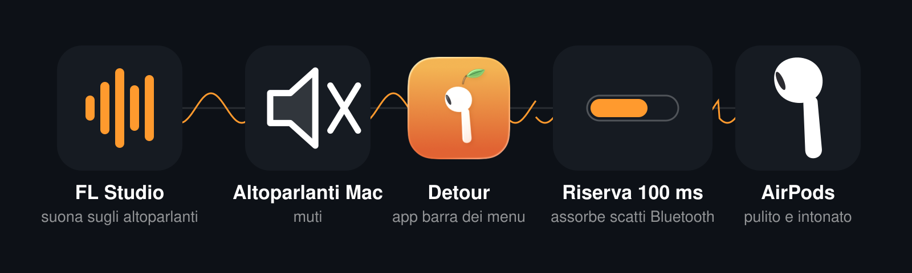
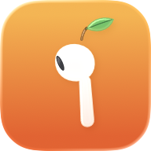
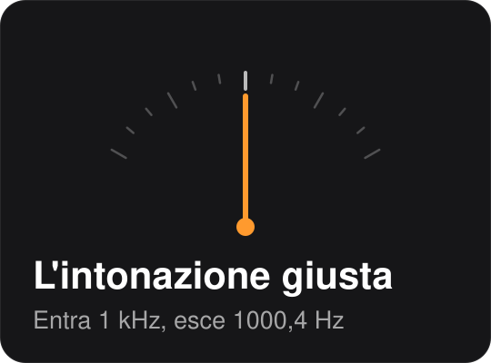

<picture>
  <source media="(prefers-color-scheme: light)" srcset="docs/assets/hero-light-it.svg">
  
</picture>

<p align="center">
  
</p>

<p align="center">
  <b>Gli AirPods con FL Studio su Mac, senza crepitii.</b><br>
  Una piccola app per la barra dei menu che riproduce il suono di FL Studio nelle tue cuffie Bluetooth, con l'intonazione giusta e senza clic.
</p>

<p align="center">
  <a href="https://github.com/adrbn/detour/releases/latest"></a>
  &nbsp;
  <a href="#come-funziona"></a>
  &nbsp;
  <a href="https://github.com/adrbn/detour/issues/new"></a>
</p>

<p align="center">
  
  
  <a href="https://github.com/adrbn/detour/releases/latest"></a>
  
  <a href="./LICENSE"></a>
</p>

<p align="center">
  Gratuito e open source · firmato e notarizzato · macOS 14.2 o successivo su Apple silicon<br>
  <a href="README.md">English</a> · <a href="README.fr.md">Français</a> · <a href="README.es.md">Español</a> · <a href="README.de.md">Deutsch</a> · <b>Italiano</b> · <a href="README.pt-BR.md">Português</a> · <a href="README.ja.md">日本語</a> · <a href="README.ko.md">한국어</a> · <a href="README.zh-Hans.md">简体中文</a> · <a href="README.ru.md">Русский</a>
</p>

---

## Il problema

Apri FL Studio sul Mac, indossi gli AirPods e il tuo progetto suona male:

- **crepitii e clic** in tutto il mix, anche su un solo sample;
- **note leggermente stonate**: l'intonazione è sbagliata, a volte oscilla;
- lo stesso progetto suona **perfetto sugli altoparlanti del MacBook**.

Le soluzioni solite non servono. Le abbiamo provate tutte: un buffer più grande, 48 kHz, l'ingresso su «none», un dispositivo aggregato, altre impostazioni audio di FL. Il suono resta rovinato, perché il problema non è un'impostazione. Quando l'uscita di FL Studio è un paio di AirPods, FL calcola male l'audio, e gli AirPods prelevano il suono a scatti irregolari che passano a tutto ciò che segue il loro clock.

C'è una trappola che peggiora le cose. L'uscita **«Default audio device»** di FL Studio segue quella predefinita del Mac, quindi FL passa ai tuoi AirPods ogni volta che si collegano, anche dopo che l'hai impostato sugli altoparlanti.

## La soluzione

Detour lascia FL Studio sugli altoparlanti del Mac, dove suona bene, silenzia gli altoparlanti e manda lo stesso suono ai tuoi AirPods, con l'intonazione giusta e senza clic. Senti il tuo progetto in cuffia come suona davvero, e in FL Studio non cambia nulla.

> Detour serve ad ascoltare, comporre e mixare. Il Bluetooth aggiunge sempre ritardo, quindi per registrare la voce o suonare a tempo le cuffie con il filo restano lo strumento giusto.

## Cosa fa

<table>
  <tr>
    <td></td>
    <td></td>
    <td></td>
  </tr>
  <tr>
    <td></td>
    <td></td>
    <td></td>
  </tr>
</table>

## Funzioni

**Suono**
- Audio pulito da FL Studio negli AirPods: niente crepitii, niente clic, intonazione corretta.
- Detour legge FL Studio sul clock stabile degli altoparlanti e alimenta gli AirPods da una riserva di 100 ms, così il loro timing Bluetooth irregolare non raggiunge mai la tua musica.
- Gli altoparlanti del Mac restano muti per tutto il tempo, anche quando gli AirPods non sono nelle orecchie.

**Uso quotidiano**
- Togli gli AirPods e rimettili: il suono torna da solo entro un secondo.
- Inizia a inviare appena FL Studio suona, e aspetta in silenzio quando non suona.
- Ti avvisa quando FL Studio stesso è passato agli AirPods (la sua impostazione «Default audio device» li segue) e ti dice cosa cambiare.
- Sta nella barra dei menu. Nessuna finestra, nessuna icona nel Dock.

**Scelta**
- FL Studio come predefinito; qualsiasi altra app che riproduce suono si può scegliere dal menu.
- Qualsiasi uscita Bluetooth: la prima collegata o quella che scegli tu.

## Per iniziare

1. **[Scarica Detour](https://github.com/adrbn/detour/releases/latest)**, apri il `.dmg` e trascina Detour in Applicazioni.
2. In FL Studio apri **Options › Audio settings** e imposta **Output** sugli altoparlanti del Mac (per esempio *Altoparlanti MacBook Pro*). Non «Default audio device»: quello segue i tuoi AirPods.
3. Apri Detour. Quando macOS lo chiede, consentilo in **Impostazioni di Sistema › Privacy e sicurezza › Registrazione schermo e audio di sistema**.
4. Indossa gli AirPods e avvia la riproduzione in FL Studio.

Le cuffie nella barra dei menu mostrano un piccolo orologio mentre Detour aspetta e un simbolo di avviso quando serve un tuo intervento. Le cuffie senza simboli indicano che il suono sta andando agli AirPods.

## Come funziona

FL Studio produce un suono pulito sugli altoparlanti del Mac e rovinato quando la sua uscita è un paio di AirPods. Abbiamo misurato perché le correzioni ovvie falliscono: gli AirPods prelevano l'audio a scatti irregolari (tra 48.128 e 50.688 campioni da un secondo all'altro, dove un dispositivo stabile ne prende 48.000), e tutto ciò che segue il loro clock eredita l'oscillazione.

Quindi Detour non lascia mai che siano gli AirPods a dettare il ritmo:

1. Un **process tap** (macOS 14.2+) cattura l'uscita di FL Studio e la silenzia sugli altoparlanti.
2. Il tap viene letto sul **clock degli altoparlanti**, lo stesso su cui FL Studio esegue il rendering.
3. Il suono passa in una **riserva di 100 ms**. Gli AirPods la leggono al loro ritmo, e una correzione molto lenta (al massimo 0,5%, mediata su diversi secondi) mantiene la riserva al giusto livello. È molto al di sotto di ciò che un orecchio percepisce come un cambio di intonazione.

Un tono di prova a 1 kHz che attraversa tutta la catena esce senza alcun clic e con un'intonazione di 1000,4 Hz.

## FAQ

**Funziona con Ableton Live, Logic o altre app?**
Scegli l'app nel menu di Detour. Finora è stato testato solo FL Studio 2026; le segnalazioni su altre app sono benvenute nelle issue.

**Altre cuffie Bluetooth?**
Detour funziona con qualsiasi uscita Bluetooth. È stato testato con gli AirPods Pro 2.

**Quanto ritardo aggiunge?**
Circa un decimo di secondo oltre al ritardo Bluetooth degli AirPods. Va bene per ascoltare e mixare, non per registrare a tempo.

**Registra qualcosa?**
No. L'audio va dal tap alle cuffie in memoria e non viene mai salvato. Detour non fa richieste di rete.

## Requisiti

- macOS 14.2 Sonoma o successivo (process tap)
- Un Mac con Apple silicon
- Cuffie Bluetooth

## Compilare dal codice sorgente

```bash
git clone https://github.com/adrbn/detour.git
cd detour
swift test
./scripts/build.sh            # compila e firma build/Detour.app
```

`NOTARY_PROFILE=<profilo> ./scripts/build.sh` notarizza anche l'app e crea il `.dmg`. Le immagini del README sono generate da `python3 docs/assets/make_svgs.py`.

## Supporto

Detour è gratuito. Se ti salva le sessioni, puoi offrirmi un caffè.

<p>
  <a href="https://ko-fi.com/adrbn"></a>
</p>

## Licenza

MIT: usalo, modificalo, condividilo, mantieni l'avviso di copyright.

<sub>Detour non è affiliato a Image-Line né ad Apple. FL Studio è un marchio di Image-Line Software; AirPods e macOS sono marchi di Apple Inc.</sub>
