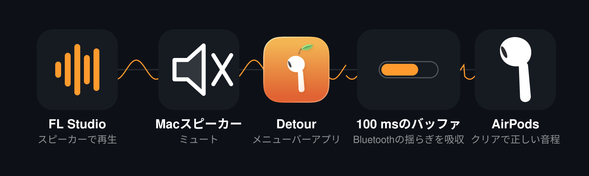
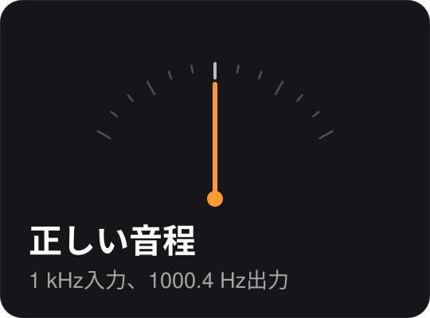

<picture>
  <source media="(prefers-color-scheme: light)" srcset="docs/assets/hero-light-ja.svg">
  
</picture>

<p align="center">
  
</p>

<p align="center">
  <b>MacのFL StudioをAirPodsで、ノイズなしで。</b><br>
  FL Studioの音を正しい音程で、クリックノイズなしにBluetoothヘッドフォンへ届ける小さなメニューバーアプリです。
</p>

<p align="center">
  <a href="https://github.com/adrbn/detour/releases/latest"></a>
  &nbsp;
  <a href="#仕組み"></a>
  &nbsp;
  <a href="https://github.com/adrbn/detour/issues/new"></a>
</p>

<p align="center">
  
  
  <a href="https://github.com/adrbn/detour/releases/latest"></a>
  
  <a href="./LICENSE"></a>
</p>

<p align="center">
  無料のオープンソース · 署名・公証済み · Apple silicon搭載MacのmacOS 14.2以降<br>
  <a href="README.md">English</a> · <a href="README.fr.md">Français</a> · <a href="README.es.md">Español</a> · <a href="README.de.md">Deutsch</a> · <a href="README.it.md">Italiano</a> · <a href="README.pt-BR.md">Português</a> · <b>日本語</b> · <a href="README.ko.md">한국어</a> · <a href="README.zh-Hans.md">简体中文</a> · <a href="README.ru.md">Русский</a>
</p>

---

## 問題

MacでFL Studioを開いてAirPodsを着けると、プロジェクトの音がおかしくなります。

- ミックス全体に**パチパチというノイズやクリック音**が出る。サンプル1つだけでも出ます。
- **音程がわずかにずれる**。ピッチが合わず、ときどき揺れます。
- 同じプロジェクトが**MacBookのスピーカーでは完璧に**鳴ります。

よくある対処法は効きません。バッファを大きくする、48 kHzにする、入力を「none」にする、機器セットを使う、FLの他のオーディオ設定を変える。私たちはどれも試しました。それでも音は直りません。問題は設定ではないからです。FL Studioは出力先がAirPodsだと音声を正しくレンダリングできず、さらにAirPodsは不規則なまとまりで音声を取り込むため、そのクロックに従うものはすべてその乱れを受け継ぎます。

事態を悪くする落とし穴もあります。FL Studioの「**Default audio device**」出力はMacのデフォルトに従うので、スピーカーに設定したあとでも、AirPodsが接続されるたびにFLはAirPodsに切り替わります。

## 解決策

DetourはFL Studioを正しく鳴るMacのスピーカーに出力させたまま、スピーカーを消音し、同じ音を正しい音程、クリックノイズなしでAirPodsに送ります。プロジェクト本来の音をヘッドフォンで聴けて、FL Studio側では何も変わりません。

> Detourは試聴、作曲、ミックスのためのものです。Bluetoothには必ず遅延があるため、ボーカルの録音やリズムに合わせた演奏には、今も有線ヘッドフォンが適しています。

## できること

<table>
  <tr>
    <td></td>
    <td></td>
    <td></td>
  </tr>
  <tr>
    <td></td>
    <td></td>
    <td></td>
  </tr>
</table>

## 機能

**サウンド**
- FL StudioからAirPodsへクリーンな音。パチパチノイズなし、クリックなし、正しい音程。
- DetourはFL Studioの音をスピーカーの安定したクロックで読み取り、100 msのバッファからAirPodsに送ります。そのため、Bluetoothの不規則なタイミングが音楽に届くことはありません。
- Macのスピーカーは、AirPodsを外している間も含めて、ずっと無音のままです。

**日々の使い方**
- AirPodsを外して着け直すと、1秒以内に自動で音が戻ります。
- FL Studioが再生を始めるとすぐに送信を始め、再生していないときは静かに待機します。
- FL Studio自体がAirPodsに切り替わったとき（「Default audio device」設定がAirPodsに追従するため）に警告し、何を変えればよいかを表示します。
- メニューバーに常駐します。ウインドウもDockアイコンもありません。

**選択**
- 標準ではFL Studio。音を出す他のアプリもメニューから選べます。
- どのBluetooth出力でも使えます。最初に接続されたもの、または自分で選んだもの。

## はじめに

1. [**Detourをダウンロード**](https://github.com/adrbn/detour/releases/latest)し、`.dmg`を開いてDetourを「アプリケーション」にドラッグします。
2. FL Studioで**Options › Audio settings**を開き、**Output**をMacのスピーカー（例：*MacBook Proのスピーカー*）に設定します。「Default audio device」は選ばないでください。こちらはAirPodsに追従します。
3. Detourを開きます。macOSから求められたら、**システム設定 › プライバシーとセキュリティ › 画面収録とシステムオーディオ録音**で許可します。
4. AirPodsを着けて、FL Studioで再生します。

メニューバーのヘッドフォンアイコンは、Detourが待機している間は小さな時計を、対応が必要なときは警告マークを表示します。ヘッドフォンだけの表示なら、音はAirPodsに送られています。

## 仕組み

FL StudioはMacのスピーカーではクリーンに、出力先がAirPodsのときは乱れた音でレンダリングします。わかりやすい対処法がなぜ効かないのかを測定しました。AirPodsは不規則なまとまりで音声を取り込み（安定したデバイスなら毎秒48,000サンプルのところ、1秒ごとに48,128〜50,688サンプル）、そのクロックに従うものはすべてこの揺れを受け継ぎます。

そこでDetourは、AirPodsにペースを決めさせません。

1. **プロセスタップ**（macOS 14.2以降）がFL Studioの出力を取り込み、スピーカー側では消音します。
2. タップは**スピーカーのクロック**で読み取ります。FL Studioがレンダリングに使っているのと同じクロックです。
3. 音は**100 msのバッファ**に入ります。AirPodsはそこから自分のペースで読み出し、ごくゆっくりした補正（最大0.5%、数秒間の平均）がバッファの量を一定に保ちます。これは耳が音程の変化として聞き取れる範囲をはるかに下回ります。

1 kHzのテストトーンをチェーン全体に通すと、クリックはゼロ、ピッチは1000.4 Hzで出てきます。

## よくある質問

**Ableton LiveやLogicなど、他のアプリでも使えますか？**
Detourのメニューでアプリを選んでください。これまでにテストしたのはFL Studio 2026だけです。他のアプリでの結果はissuesでお知らせください。

**他のBluetoothヘッドフォンでも使えますか？**
DetourはどのBluetooth出力でも動作します。テストにはAirPods Pro 2を使いました。

**遅延はどのくらい増えますか？**
AirPods自体のBluetooth遅延に加えて、約0.1秒です。試聴やミックスには問題ありませんが、リズムに合わせた録音には向きません。

**何か録音されますか？**
いいえ。音声はメモリ上でタップからヘッドフォンへ送られるだけで、保存されることはありません。Detourはネットワーク通信を一切行いません。

## 動作環境

- macOS 14.2 Sonoma以降（プロセスタップを使うため）
- Apple silicon搭載のMac
- Bluetoothヘッドフォン

## ソースからビルド

```bash
git clone https://github.com/adrbn/detour.git
cd detour
swift test
./scripts/build.sh            # build/Detour.appをビルドして署名
```

`NOTARY_PROFILE=<プロファイル> ./scripts/build.sh`を使うと、アプリの公証と`.dmg`の作成も行います。READMEの画像は`python3 docs/assets/make_svgs.py`で生成しています。

## サポート

Detourは無料です。セッションの役に立ったら、コーヒーをおごってもらえるとうれしいです。

<p>
  <a href="https://ko-fi.com/adrbn"></a>
</p>

## ライセンス

MIT：自由に使用、改変、共有できます。著作権表示は残してください。

<sub>DetourはImage-Line、Appleのいずれとも提携関係にありません。FL StudioはImage-Line Softwareの商標です。AirPodsおよびmacOSはApple Inc.の商標です。</sub>
