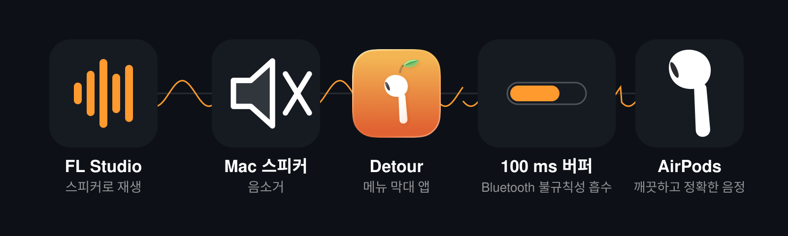
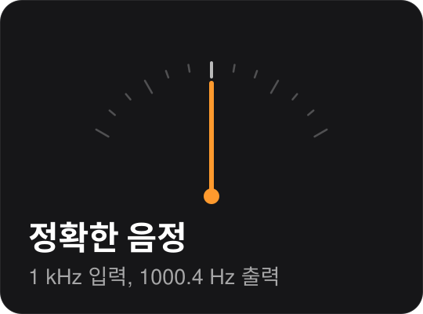

<picture>
  <source media="(prefers-color-scheme: light)" srcset="docs/assets/hero-light-ko.svg">
  
</picture>

<p align="center">
  
</p>

<p align="center">
  <b>Mac의 FL Studio를 AirPods로, 잡음 없이.</b><br>
  FL Studio의 소리를 정확한 음정으로, 클릭 노이즈 없이 Bluetooth 헤드폰에 보내 주는 작은 메뉴 막대 앱입니다.
</p>

<p align="center">
  <a href="https://github.com/adrbn/detour/releases/latest"></a>
  &nbsp;
  <a href="#작동-방식"></a>
  &nbsp;
  <a href="https://github.com/adrbn/detour/issues/new"></a>
</p>

<p align="center">
  
  
  <a href="https://github.com/adrbn/detour/releases/latest"></a>
  
  <a href="./LICENSE"></a>
</p>

<p align="center">
  무료 오픈 소스 · 서명 및 공증 완료 · Apple silicon Mac의 macOS 14.2 이상<br>
  <a href="README.md">English</a> · <a href="README.fr.md">Français</a> · <a href="README.es.md">Español</a> · <a href="README.de.md">Deutsch</a> · <a href="README.it.md">Italiano</a> · <a href="README.pt-BR.md">Português</a> · <a href="README.ja.md">日本語</a> · <b>한국어</b> · <a href="README.zh-Hans.md">简体中文</a> · <a href="README.ru.md">Русский</a>
</p>

---

## 문제

Mac에서 FL Studio를 열고 AirPods를 끼면 프로젝트 소리가 이상해집니다.

- 믹스 전체에 **지직거림과 클릭 노이즈**가 생깁니다. 샘플 하나만 재생해도 그렇습니다.
- **음정이 살짝 어긋납니다**. 피치가 맞지 않고 가끔 흔들립니다.
- 같은 프로젝트가 **MacBook 스피커에서는 완벽하게** 들립니다.

흔히 쓰는 해결책은 소용이 없습니다. 버퍼 키우기, 48 kHz, 입력을 "none"으로 설정, 통합 기기, FL의 다른 오디오 설정까지 하나씩 모두 시도해 봤습니다. 그래도 소리는 망가진 채로 남습니다. 문제가 설정에 있지 않기 때문입니다. FL Studio는 출력이 AirPods일 때 오디오를 제대로 렌더링하지 못하고, AirPods는 불규칙한 덩어리로 오디오를 가져가기 때문에 그 클럭을 따르는 것은 모두 그 흔들림을 물려받습니다.

상황을 더 나쁘게 만드는 함정도 있습니다. FL Studio의 "**Default audio device**" 출력은 Mac의 기본 출력을 따르기 때문에, 스피커로 설정해 두어도 AirPods가 연결될 때마다 FL이 AirPods로 바뀝니다.

## 해결 방법

Detour는 FL Studio를 소리가 제대로 나는 Mac 스피커에 그대로 두고, 스피커를 음소거한 뒤, 같은 소리를 정확한 음정으로 클릭 노이즈 없이 AirPods에 보냅니다. 프로젝트의 실제 소리를 헤드폰으로 들을 수 있고, FL Studio 안에서는 아무것도 바뀌지 않습니다.

> Detour는 감상, 작곡, 믹싱을 위한 앱입니다. Bluetooth는 항상 지연을 더하므로, 보컬 녹음이나 박자에 맞춘 연주에는 여전히 유선 헤드폰이 알맞습니다.

## 하는 일

<table>
  <tr>
    <td></td>
    <td></td>
    <td></td>
  </tr>
  <tr>
    <td></td>
    <td></td>
    <td></td>
  </tr>
</table>

## 기능

**사운드**
- FL Studio의 소리를 AirPods에서 깨끗하게: 지직거림 없음, 클릭 없음, 정확한 음정.
- Detour는 FL Studio를 스피커의 안정적인 클럭으로 읽고 100 ms 버퍼에서 AirPods로 보냅니다. 그래서 고르지 않은 Bluetooth 타이밍이 음악에 닿지 않습니다.
- Mac 스피커는 AirPods를 빼고 있는 동안을 포함해 내내 조용합니다.

**일상 사용**
- AirPods를 뺐다가 다시 끼면 1초 안에 소리가 저절로 돌아옵니다.
- FL Studio가 재생을 시작하면 바로 전송을 시작하고, 재생하지 않을 때는 조용히 기다립니다.
- FL Studio 자체가 AirPods로 전환되면("Default audio device" 설정이 AirPods를 따라가기 때문입니다) 알려 주고, 무엇을 바꿔야 하는지 안내합니다.
- 메뉴 막대에 있습니다. 윈도우도, Dock 아이콘도 없습니다.

**선택**
- 기본값은 FL Studio이며, 소리를 내는 다른 앱도 메뉴에서 고를 수 있습니다.
- 어떤 Bluetooth 출력이든 사용할 수 있습니다. 처음 연결된 기기 또는 직접 고른 기기.

## 시작하기

1. [**Detour를 다운로드**](https://github.com/adrbn/detour/releases/latest)하고 `.dmg`를 연 다음 Detour를 응용 프로그램 폴더로 드래그합니다.
2. FL Studio에서 **Options › Audio settings**를 열고 **Output**을 Mac 스피커(예: *MacBook Pro 스피커*)로 설정합니다. "Default audio device"는 고르지 않습니다. 그 항목은 AirPods를 따라갑니다.
3. Detour를 엽니다. macOS가 요청하면 **시스템 설정 › 개인정보 보호 및 보안 › 화면 및 시스템 오디오 녹음**에서 허용합니다.
4. AirPods를 끼고 FL Studio에서 재생합니다.

메뉴 막대의 헤드폰 아이콘은 Detour가 기다리는 동안 작은 시계를, 확인이 필요할 때는 경고 표시를 보여 줍니다. 헤드폰만 보이면 소리가 AirPods로 가고 있다는 뜻입니다.

## 작동 방식

FL Studio는 Mac 스피커에서는 깨끗하게, 출력이 AirPods일 때는 망가진 소리로 렌더링합니다. 뻔한 해결책이 왜 실패하는지 측정해 봤습니다. AirPods는 불규칙한 덩어리로 오디오를 가져가고(안정적인 기기는 초당 48,000 샘플을 가져가지만, AirPods는 1초마다 48,128~50,688 샘플 사이를 오갑니다), 그 클럭을 따르는 것은 모두 이 흔들림을 물려받습니다.

그래서 Detour는 AirPods가 속도를 정하게 두지 않습니다.

1. **프로세스 탭**(macOS 14.2+)이 FL Studio의 출력을 가져오고 스피커에서는 음소거합니다.
2. 탭은 **스피커의 클럭**으로 읽습니다. FL Studio가 렌더링하는 것과 같은 클럭입니다.
3. 소리는 **100 ms 버퍼**로 들어갑니다. AirPods는 여기서 자기 속도대로 읽어 가고, 아주 느린 보정(최대 0.5%, 몇 초에 걸친 평균)이 버퍼 수준을 일정하게 유지합니다. 귀가 음정 변화로 들을 수 있는 수준보다 훨씬 낮습니다.

1 kHz 테스트 톤을 전체 체인에 통과시키면 클릭은 0개, 피치는 1000.4 Hz로 나옵니다.

## 자주 묻는 질문

**Ableton Live, Logic 등 다른 앱에서도 작동합니까?**
Detour 메뉴에서 앱을 선택하면 됩니다. 지금까지는 FL Studio 2026만 테스트했습니다. 다른 앱에서 사용해 본 결과는 issues에 남겨 주시면 감사하겠습니다.

**다른 Bluetooth 헤드폰에서도 작동합니까?**
Detour는 모든 Bluetooth 출력에서 작동합니다. AirPods Pro 2로 테스트했습니다.

**지연은 얼마나 늘어납니까?**
AirPods 자체의 Bluetooth 지연에 더해 약 0.1초입니다. 감상과 믹싱에는 충분하지만, 박자에 맞춘 녹음에는 맞지 않습니다.

**무언가를 녹음합니까?**
아니요. 오디오는 메모리 안에서 탭에서 헤드폰으로 전달될 뿐, 저장되지 않습니다. Detour는 네트워크 요청을 전혀 하지 않습니다.

## 요구 사항

- macOS 14.2 Sonoma 이상(프로세스 탭)
- Apple silicon Mac
- Bluetooth 헤드폰

## 소스에서 빌드

```bash
git clone https://github.com/adrbn/detour.git
cd detour
swift test
./scripts/build.sh            # build/Detour.app을 빌드하고 서명
```

`NOTARY_PROFILE=<프로필> ./scripts/build.sh`를 쓰면 앱 공증과 `.dmg` 생성까지 합니다. README 이미지는 `python3 docs/assets/make_svgs.py`로 생성합니다.

## 후원

Detour는 무료입니다. 작업 세션에 도움이 되었다면 커피 한 잔으로 응원해 주실 수 있습니다.

<p>
  <a href="https://ko-fi.com/adrbn"></a>
</p>

## 라이선스

MIT: 자유롭게 사용, 수정, 공유할 수 있으며, 저작권 고지는 유지해야 합니다.

<sub>Detour는 Image-Line 및 Apple과 제휴 관계가 없습니다. FL Studio는 Image-Line Software의 상표이며, AirPods와 macOS는 Apple Inc.의 상표입니다.</sub>
