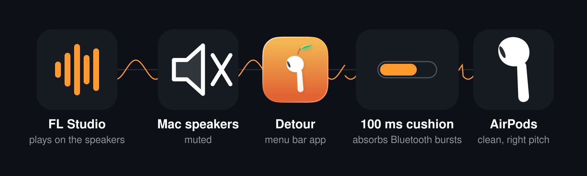
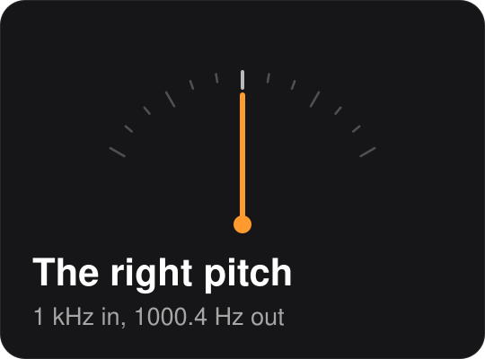
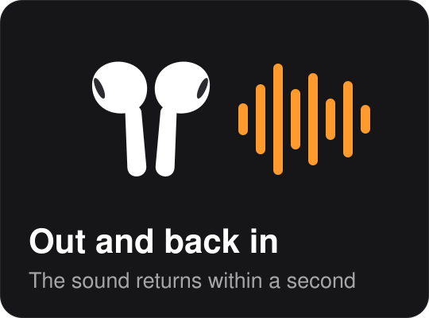

<picture>
  <source media="(prefers-color-scheme: light)" srcset="docs/assets/hero-light.svg">
  
</picture>

<p align="center">
  
</p>

<p align="center">
  <b>AirPods with FL Studio on Mac, without the crackles.</b><br>
  A tiny menu bar app that plays FL Studio's sound in your Bluetooth headphones at the right pitch, with no clicks.
</p>

<p align="center">
  <a href="https://github.com/adrbn/detour/releases/latest"></a>
  &nbsp;
  <a href="#how-it-works"></a>
  &nbsp;
  <a href="https://github.com/adrbn/detour/issues/new"></a>
</p>

<p align="center">
  
  
  <a href="https://github.com/adrbn/detour/releases/latest"></a>
  
  <a href="./LICENSE"></a>
</p>

<p align="center">
  Free and open source · signed and notarized · macOS 14.2 or later on Apple silicon<br>
  <b>English</b> · <a href="README.fr.md">Français</a>
</p>

---

## The problem

You open FL Studio on your Mac, put your AirPods in, and your project sounds wrong:

- **crackles and clicks** all over the mix, even on a single sample;
- **notes slightly out of tune**: the pitch is off, sometimes wobbling;
- the same project sounds **perfect on the MacBook speakers**.

The usual fixes don't help. We tried each one: a bigger buffer, 48 kHz, input set to "none", an aggregate device, other FL audio settings. The sound stays broken, because the problem isn't a setting. When FL Studio's output is a pair of AirPods, it renders its audio badly, and AirPods pull audio in irregular bursts that anything following their clock inherits.

There's a trap that makes it worse. FL Studio's **"Default audio device"** output follows the Mac's default, so FL switches to your AirPods every time they connect, even after you set it to the speakers.

## The fix

Detour leaves FL Studio on the Mac speakers, where it sounds right, silences the speakers, and sends the same sound to your AirPods at the right pitch, with no clicks. You hear your project the way it really sounds, in your headphones, and nothing changes inside FL Studio.

> Detour is for listening, composing and mixing. Bluetooth always adds delay, so for recording vocals or playing in time, wired headphones are still the right tool.

## What it does

<table>
  <tr>
    <td></td>
    <td></td>
    <td></td>
  </tr>
  <tr>
    <td></td>
    <td></td>
    <td></td>
  </tr>
</table>

## Features

**Sound**
- Clean audio in AirPods from FL Studio: no crackles, no clicks, correct pitch.
- Detour reads FL Studio on the speakers' steady clock and feeds the AirPods from a 100 ms cushion, so their uneven Bluetooth timing never reaches your music.
- The Mac speakers stay silent the whole time, including while your AirPods are out.

**Everyday use**
- Take your AirPods out and put them back: the sound comes back by itself within a second.
- Starts sending as soon as FL Studio plays, and waits quietly when it doesn't.
- Warns you when FL Studio itself has switched to the AirPods (its "Default audio device" setting follows them), and tells you what to change.
- Lives in the menu bar. No window, no Dock icon.

**Choice**
- FL Studio by default; any other app that plays sound can be picked from the menu.
- Any Bluetooth output: the first one connected, or one you choose.

## Get started

1. **[Download Detour](https://github.com/adrbn/detour/releases/latest)**, open the `.dmg` and drag Detour to Applications.
2. In FL Studio, open **Options › Audio settings** and set **Output** to your Mac's speakers (for example *MacBook Pro Speakers*). Not "Default audio device": that one follows your AirPods.
3. Open Detour. When macOS asks, allow it under **System Settings › Privacy & Security › Screen & System Audio Recording**.
4. Put your AirPods in and press play in FL Studio.

The headphones icon in the menu bar fills in when sound is going to your AirPods.

## How it works

FL Studio renders cleanly on the Mac speakers and badly when its output is a pair of AirPods. We measured why the obvious fixes fail: AirPods pull audio in irregular bursts (between 48,128 and 50,688 samples from one second to the next, where a steady device takes 48,000), and anything that follows their clock inherits the wobble.

So Detour never lets the AirPods set the pace:

1. A **process tap** (macOS 14.2+) captures FL Studio's output and mutes it on the speakers.
2. The tap is read on the **speakers' clock**, the same one FL Studio is rendering on.
3. The sound goes into a **100 ms cushion**. The AirPods read from it at their own pace, and a very slow correction (at most 0.5 %, averaged over several seconds) keeps the cushion level. That is far below what an ear can hear as a pitch change.

A 1 kHz test tone through the whole chain comes out with zero clicks and a pitch of 1000.4 Hz.

## FAQ

**Does it work with Ableton Live, Logic or other apps?**
Pick the app in the Detour menu. Only FL Studio 2026 has been tested so far; reports for other apps are welcome in the issues.

**Other Bluetooth headphones?**
Detour works with any Bluetooth output. It has been tested with AirPods Pro 2.

**How much delay does it add?**
About a tenth of a second on top of the AirPods' own Bluetooth delay. Fine for listening and mixing, not for recording in time.

**Does it record anything?**
No. The audio goes from the tap to the headphones in memory and is never saved. Detour makes no network requests.

## Requirements

- macOS 14.2 Sonoma or later (process taps)
- A Mac with Apple silicon
- Bluetooth headphones

## Build from source

```bash
git clone https://github.com/adrbn/detour.git
cd detour
swift test
./scripts/build.sh            # builds and signs build/Detour.app
```

`NOTARY_PROFILE=<profile> ./scripts/build.sh` also notarizes the app and builds the `.dmg`. The README art is generated by `python3 docs/assets/make_svgs.py`.

## Support

Detour is free. If it saves your sessions, you can buy me a coffee.

<p>
  <a href="https://ko-fi.com/adrbn"></a>
</p>

## License

MIT: use it, change it, share it, keep the copyright notice.

<sub>Detour is not affiliated with Image-Line or Apple. FL Studio is a trademark of Image-Line Software; AirPods and macOS are trademarks of Apple Inc.</sub>
