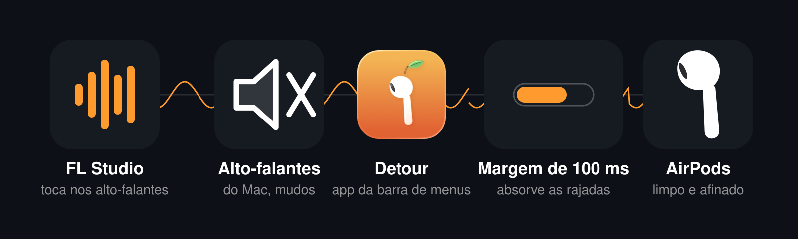

<picture>
  <source media="(prefers-color-scheme: light)" srcset="docs/assets/hero-light-pt-BR.svg">
  
</picture>

<p align="center">
  
</p>

<p align="center">
  <b>AirPods com o FL Studio no Mac, sem os estalos.</b><br>
  Um pequeno app de barra de menus que toca o som do FL Studio nos seus fones Bluetooth na afinação certa, sem cliques.
</p>

<p align="center">
  <a href="https://github.com/adrbn/detour/releases/latest"></a>
  &nbsp;
  <a href="#como-funciona"></a>
  &nbsp;
  <a href="https://github.com/adrbn/detour/issues/new"></a>
</p>

<p align="center">
  
  
  <a href="https://github.com/adrbn/detour/releases/latest"></a>
  
  <a href="./LICENSE"></a>
</p>

<p align="center">
  Gratuito e de código aberto · assinado e notarizado · macOS 14.2 ou posterior em Apple silicon<br>
  <a href="README.md">English</a> · <a href="README.fr.md">Français</a> · <a href="README.es.md">Español</a> · <a href="README.de.md">Deutsch</a> · <a href="README.it.md">Italiano</a> · <b>Português</b> · <a href="README.ja.md">日本語</a> · <a href="README.ko.md">한국어</a> · <a href="README.zh-Hans.md">简体中文</a> · <a href="README.ru.md">Русский</a>
</p>

---

## O problema

Você abre o FL Studio no Mac, coloca os AirPods e o seu projeto soa errado:

- **estalos e cliques** pela mixagem toda, até em um único sample;
- **notas levemente desafinadas**: a afinação sai do lugar e às vezes oscila;
- o mesmo projeto soa **perfeito nos alto-falantes do MacBook**.

As soluções de sempre não adiantam. Testamos cada uma: um buffer maior, 48 kHz, a entrada em “none”, um dispositivo agregado, outras configurações de áudio do FL. O som continua quebrado, porque o problema não é uma configuração. Quando a saída do FL Studio é um par de AirPods, ele renderiza mal o áudio, e os AirPods puxam o áudio em rajadas irregulares, que passam para tudo o que segue o relógio deles.

Tem uma armadilha que piora as coisas. A saída **“Default audio device”** do FL Studio segue a saída padrão do Mac, então o FL muda para os AirPods toda vez que eles se conectam, mesmo depois de você escolher os alto-falantes.

## A solução

O Detour deixa o FL Studio nos alto-falantes do Mac, onde ele soa certo, silencia os alto-falantes e manda o mesmo som para os seus AirPods na afinação certa, sem cliques. Você ouve o projeto como ele realmente soa, nos seus fones, sem mudar nada no FL Studio.

> O Detour serve para ouvir, compor e mixar. O Bluetooth sempre adiciona atraso, então para gravar voz ou tocar no tempo, fones com fio continuam sendo a ferramenta certa.

## O que ele faz

<table>
  <tr>
    <td></td>
    <td></td>
    <td></td>
  </tr>
  <tr>
    <td></td>
    <td></td>
    <td></td>
  </tr>
</table>

## Recursos

**Som**
- Áudio limpo nos AirPods a partir do FL Studio: sem estalos, sem cliques, na afinação certa.
- O Detour lê o FL Studio no relógio estável dos alto-falantes e alimenta os AirPods a partir de uma margem de 100 ms, então o ritmo irregular do Bluetooth deles nunca chega à sua música.
- Os alto-falantes do Mac ficam mudos o tempo todo, inclusive enquanto os AirPods estão fora.

**No dia a dia**
- Tire os AirPods e coloque de volta: o som volta sozinho em até um segundo.
- Começa a enviar assim que o FL Studio toca e espera em silêncio quando ele não toca.
- Avisa quando o próprio FL Studio mudou para os AirPods (a configuração “Default audio device” dele segue os fones) e diz o que mudar.
- Fica na barra de menus. Sem janela, sem ícone no Dock.

**Escolha**
- FL Studio por padrão; qualquer outro app que toque som pode ser escolhido no menu.
- Qualquer saída Bluetooth: a primeira conectada ou a que você escolher.

## Primeiros passos

1. **[Baixe o Detour](https://github.com/adrbn/detour/releases/latest)**, abra o `.dmg` e arraste o Detour para Aplicativos.
2. No FL Studio, abra **Options › Audio settings** e defina **Output** como os alto-falantes do Mac (por exemplo, *Alto-falantes do MacBook Pro*). Não “Default audio device”: esse segue os seus AirPods.
3. Abra o Detour. Quando o macOS pedir, permita em **Ajustes do Sistema › Privacidade e Segurança › Gravação do Áudio do Sistema e da Tela**.
4. Coloque os AirPods e dê play no FL Studio.

Os fones na barra de menus mostram um pequeno relógio enquanto o Detour espera e um sinal de alerta quando algo precisa de você. Fones sem nenhum sinal querem dizer que o som está indo para os AirPods.

## Como funciona

O FL Studio renderiza limpo nos alto-falantes do Mac e mal quando a saída é um par de AirPods. Medimos por que as correções óbvias falham: os AirPods puxam o áudio em rajadas irregulares (entre 48.128 e 50.688 amostras de um segundo para o outro, quando um dispositivo estável pega 48.000), e tudo o que segue o relógio deles herda essa oscilação.

Por isso o Detour nunca deixa os AirPods ditarem o ritmo:

1. Um **process tap** (macOS 14.2+) captura a saída do FL Studio e a silencia nos alto-falantes.
2. O tap é lido no **relógio dos alto-falantes**, o mesmo em que o FL Studio renderiza.
3. O som entra em uma **margem de 100 ms**. Os AirPods leem dela no próprio ritmo, e uma correção muito lenta (no máximo 0,5%, em média ao longo de vários segundos) mantém o nível da margem estável. Isso fica muito abaixo do que um ouvido percebe como mudança de afinação.

Um tom de teste de 1 kHz passando pela cadeia inteira sai sem nenhum clique e a 1000,4 Hz.

## Perguntas frequentes

**Funciona com Ableton Live, Logic ou outros apps?**
Escolha o app no menu do Detour. Até agora só o FL Studio 2026 foi testado; relatos sobre outros apps são bem-vindos nas issues.

**Outros fones Bluetooth?**
O Detour funciona com qualquer saída Bluetooth. Ele foi testado com AirPods Pro 2.

**Quanto atraso ele adiciona?**
Cerca de um décimo de segundo além do atraso Bluetooth dos próprios AirPods. Tudo bem para ouvir e mixar, não para gravar no tempo.

**Ele grava alguma coisa?**
Não. O áudio vai do tap para os fones na memória e nunca é salvo. O Detour não faz nenhuma requisição de rede.

## Requisitos

- macOS 14.2 Sonoma ou posterior (process taps)
- Um Mac com Apple silicon
- Fones de ouvido Bluetooth

## Compilar a partir do código-fonte

```bash
git clone https://github.com/adrbn/detour.git
cd detour
swift test
./scripts/build.sh            # compila e assina build/Detour.app
```

`NOTARY_PROFILE=<perfil> ./scripts/build.sh` também notariza o app e gera o `.dmg`. As imagens do README são geradas por `python3 docs/assets/make_svgs.py`.

## Apoio

O Detour é gratuito. Se ele salvar as suas sessões, você pode me pagar um café.

<p>
  <a href="https://ko-fi.com/adrbn"></a>
</p>

## Licença

MIT: use, modifique, compartilhe e mantenha o aviso de copyright.

<sub>O Detour não é afiliado à Image-Line nem à Apple. FL Studio é uma marca comercial da Image-Line Software; AirPods e macOS são marcas comerciais da Apple Inc.</sub>
