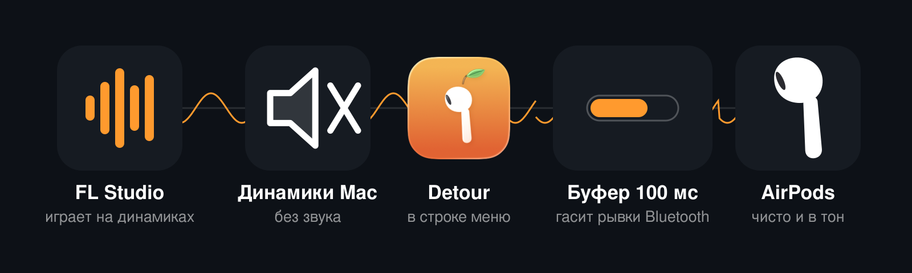

<picture>
  <source media="(prefers-color-scheme: light)" srcset="docs/assets/hero-light-ru.svg">
  
</picture>

<p align="center">
  
</p>

<p align="center">
  <b>AirPods с FL Studio на Mac, без треска.</b><br>
  Маленькое приложение для строки меню, которое выводит звук FL Studio в Bluetooth-наушники с верной высотой тона и без щелчков.
</p>

<p align="center">
  <a href="https://github.com/adrbn/detour/releases/latest"></a>
  &nbsp;
  <a href="#как-это-работает"></a>
  &nbsp;
  <a href="https://github.com/adrbn/detour/issues/new"></a>
</p>

<p align="center">
  
  
  <a href="https://github.com/adrbn/detour/releases/latest"></a>
  
  <a href="./LICENSE"></a>
</p>

<p align="center">
  Бесплатно и с открытым кодом · подписано и нотаризовано · macOS 14.2 или новее на Apple silicon<br>
  <a href="README.md">English</a> · <a href="README.fr.md">Français</a> · <a href="README.es.md">Español</a> · <a href="README.de.md">Deutsch</a> · <a href="README.it.md">Italiano</a> · <a href="README.pt-BR.md">Português</a> · <a href="README.ja.md">日本語</a> · <a href="README.ko.md">한국어</a> · <a href="README.zh-Hans.md">简体中文</a> · <b>Русский</b>
</p>

---

## Проблема

Вы открываете FL Studio на Mac, вставляете AirPods, и проект звучит не так:

- **треск и щелчки** по всему миксу, даже на одном сэмпле;
- **ноты чуть фальшивят**: высота тона смещена, иногда плавает;
- тот же проект звучит **идеально на динамиках MacBook**.

Обычные советы не помогают. Мы попробовали каждый: буфер побольше, 48 кГц, вход «none», агрегатное устройство, другие аудионастройки FL. Звук остаётся испорченным, потому что дело не в настройках. Когда выход FL Studio направлен на AirPods, он плохо рендерит звук, а AirPods забирают аудио неравномерными рывками, и всё, что синхронизируется с их часами, наследует эти рывки.

Есть ещё ловушка, которая всё усугубляет. Выход FL Studio **«Default audio device»** следует за устройством Mac по умолчанию, поэтому FL переключается на AirPods при каждом их подключении, даже если вы уже выбрали динамики.

## Решение

Detour оставляет FL Studio на динамиках Mac, где он звучит правильно, глушит динамики и отправляет тот же звук в AirPods с верной высотой тона и без щелчков. Вы слышите в наушниках, как проект звучит на самом деле, и в FL Studio ничего менять не нужно.

> Detour нужен для прослушивания, сочинения и сведения. Bluetooth всегда добавляет задержку, поэтому для записи вокала или игры в такт по-прежнему лучше проводные наушники.

## Что делает Detour

<table>
  <tr>
    <td></td>
    <td></td>
    <td></td>
  </tr>
  <tr>
    <td></td>
    <td></td>
    <td></td>
  </tr>
</table>

## Возможности

**Звук**
- Чистый звук FL Studio в AirPods: без треска, без щелчков, с верной высотой тона.
- Detour читает FL Studio по ровным часам динамиков и подаёт звук в AirPods из буфера на 100 мс, так что неровный ритм Bluetooth никогда не доходит до вашей музыки.
- Динамики Mac молчат всё время, в том числе когда AirPods не в ушах.

**Каждый день**
- Выньте AirPods и вставьте обратно: звук сам вернётся меньше чем за секунду.
- Начинает отправку, как только FL Studio играет, и тихо ждёт, когда не играет.
- Предупреждает, если FL Studio сам переключился на AirPods (его настройка «Default audio device» следует за ними), и подсказывает, что изменить.
- Живёт в строке меню. Ни окна, ни значка в Dock.

**Выбор**
- По умолчанию FL Studio; любое другое приложение со звуком можно выбрать в меню.
- Любой Bluetooth-выход: первый подключённый или тот, что вы выберете.

## Начало работы

1. **[Скачайте Detour](https://github.com/adrbn/detour/releases/latest)**, откройте `.dmg` и перетащите Detour в папку «Программы».
2. В FL Studio откройте **Options › Audio settings** и выберите в **Output** динамики Mac (например, *Динамики MacBook Pro*). Не «Default audio device»: он следует за AirPods.
3. Откройте Detour. Когда macOS спросит, разрешите доступ в **Системные настройки › Конфиденциальность и безопасность › Запись экрана и системного звука**.
4. Вставьте AirPods и запустите воспроизведение в FL Studio.

Значок наушников в строке меню показывает маленькие часы, пока Detour ждёт, и знак предупреждения, когда нужно ваше вмешательство. Просто наушники означают, что звук идёт в AirPods.

## Как это работает

FL Studio чисто рендерит звук на динамиках Mac и плохо, когда его выход направлен на AirPods. Мы измерили, почему очевидные решения не работают: AirPods забирают аудио неравномерными рывками (от 48 128 до 50 688 сэмплов от секунды к секунде, тогда как ровное устройство берёт 48 000), и всё, что синхронизируется с их часами, наследует эти колебания.

Поэтому Detour никогда не позволяет AirPods задавать темп:

1. **Process tap** (macOS 14.2+) захватывает выход FL Studio и глушит его на динамиках.
2. Tap читается по **часам динамиков**, тем же, по которым рендерит FL Studio.
3. Звук попадает в **буфер на 100 мс**. AirPods забирают из него в своём темпе, а очень медленная коррекция (не больше 0,5 %, усреднённая за несколько секунд) удерживает уровень буфера. Это намного ниже того, что ухо слышит как изменение высоты тона.

Тестовый тон 1 кГц, пройдя всю цепочку, выходит без единого щелчка, с частотой 1000,4 Гц.

## Частые вопросы

**Работает ли это с Ableton Live, Logic или другими приложениями?**
Выберите приложение в меню Detour. Пока протестирован только FL Studio 2026; отзывы о других приложениях ждём в issues.

**А другие Bluetooth-наушники?**
Detour работает с любым Bluetooth-выходом. Он протестирован с AirPods Pro 2.

**Какую задержку он добавляет?**
Около десятой доли секунды сверх собственной Bluetooth-задержки AirPods. Подходит для прослушивания и сведения, но не для записи в такт.

**Он что-нибудь записывает?**
Нет. Звук идёт от tap к наушникам в памяти и никогда не сохраняется. Detour не делает никаких сетевых запросов.

## Требования

- macOS 14.2 Sonoma или новее (process taps)
- Mac с Apple silicon
- Bluetooth-наушники

## Сборка из исходников

```bash
git clone https://github.com/adrbn/detour.git
cd detour
swift test
./scripts/build.sh            # собирает и подписывает build/Detour.app
```

`NOTARY_PROFILE=<профиль> ./scripts/build.sh` также нотаризует приложение и собирает `.dmg`. Иллюстрации README генерирует `python3 docs/assets/make_svgs.py`.

## Поддержка

Detour бесплатен. Если он спасает ваши сессии, можете угостить меня кофе.

<p>
  <a href="https://ko-fi.com/adrbn"></a>
</p>

## Лицензия

MIT: используйте, изменяйте, распространяйте, сохраняя уведомление об авторских правах.

<sub>Detour не связан ни с Image-Line, ни с Apple. FL Studio является товарным знаком Image-Line Software; AirPods и macOS являются товарными знаками Apple Inc.</sub>
