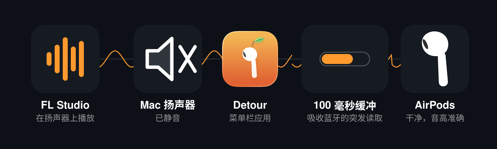
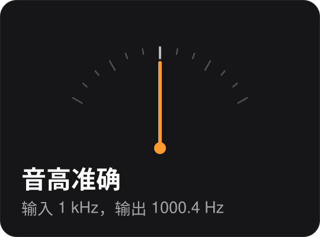

<picture>
  <source media="(prefers-color-scheme: light)" srcset="docs/assets/hero-light-zh-Hans.svg">
  
</picture>

<p align="center">
  
</p>

<p align="center">
  <b>在 Mac 上用 AirPods 听 FL Studio，不再爆音。</b><br>
  一个小巧的菜单栏应用，把 FL Studio 的声音送进你的蓝牙耳机，音高准确，没有咔哒声。
</p>

<p align="center">
  <a href="https://github.com/adrbn/detour/releases/latest"></a>
  &nbsp;
  <a href="#工作原理"></a>
  &nbsp;
  <a href="https://github.com/adrbn/detour/issues/new"></a>
</p>

<p align="center">
  
  
  <a href="https://github.com/adrbn/detour/releases/latest"></a>
  
  <a href="./LICENSE"></a>
</p>

<p align="center">
  免费开源 · 已签名并经过公证 · 需要 macOS 14.2 或更高版本及 Apple silicon<br>
  <a href="README.md">English</a> · <a href="README.fr.md">Français</a> · <a href="README.es.md">Español</a> · <a href="README.de.md">Deutsch</a> · <a href="README.it.md">Italiano</a> · <a href="README.pt-BR.md">Português</a> · <a href="README.ja.md">日本語</a> · <a href="README.ko.md">한국어</a> · <b>简体中文</b> · <a href="README.ru.md">Русский</a>
</p>

---

## 问题

你在 Mac 上打开 FL Studio，戴上 AirPods，项目听起来却不对劲：

- 整个混音里到处是**爆音和咔哒声**，哪怕只放一个采样；
- **音符有点跑调**：音高偏了，有时还会摇晃；
- 同一个项目在 **MacBook 扬声器上听起来完全正常**。

常见的办法都没用。我们一个个试过：加大缓冲区、改成 48 kHz、把输入设为“none”、用聚集设备、调整 FL 的其他音频设置。声音依旧不对，因为问题不在设置。当 FL Studio 的输出是 AirPods 时，它渲染出的音频本身就有问题；而 AirPods 以不规则的突发方式拉取音频，任何跟随它们时钟的东西都会继承这种不稳定。

还有一个陷阱让情况更糟。FL Studio 的 **“Default audio device”** 输出会跟随 Mac 的默认设备，所以每次 AirPods 连接时，FL 都会切换到 AirPods，即使你已经把它设成了扬声器。

## 解决方法

Detour 让 FL Studio 继续输出到 Mac 扬声器（在那里它的声音是对的），把扬声器静音，再把同样的声音送到 AirPods，音高准确，没有咔哒声。你在耳机里听到的就是项目真实的声音，FL Studio 里什么都不用改。

> Detour 用于试听、作曲和混音。蓝牙总会带来延迟，所以录人声或跟着节拍演奏时，有线耳机仍然是合适的选择。

## 它能做什么

<table>
  <tr>
    <td></td>
    <td></td>
    <td></td>
  </tr>
  <tr>
    <td></td>
    <td></td>
    <td></td>
  </tr>
</table>

## 功能

**声音**
- 从 FL Studio 到 AirPods 的声音干净：没有爆音，没有咔哒声，音高准确。
- Detour 按扬声器稳定的时钟读取 FL Studio，再从 100 毫秒的缓冲中为 AirPods 供给音频，因此 AirPods 不均匀的蓝牙时序永远不会影响你的音乐。
- Mac 扬声器全程保持静音，摘下 AirPods 时也一样。

**日常使用**
- 摘下 AirPods 再戴上：声音会在一秒内自动恢复。
- FL Studio 一开始播放就开始发送，没有播放时安静等待。
- 当 FL Studio 自己切换到 AirPods 时（它的“Default audio device”设置会跟随 AirPods）提醒你，并告诉你该改什么。
- 常驻菜单栏。没有窗口，也没有程序坞图标。

**选择**
- 默认是 FL Studio；任何其他会发声的应用都可以在菜单中选择。
- 任意蓝牙输出：第一个连接的设备，或你指定的设备。

## 快速上手

1. **[下载 Detour](https://github.com/adrbn/detour/releases/latest)**，打开 `.dmg`，把 Detour 拖到“应用程序”文件夹。
2. 在 FL Studio 中打开 **Options › Audio settings**，把 **Output** 设为 Mac 的扬声器（例如 *MacBook Pro扬声器*）。不要选“Default audio device”：它会跟随你的 AirPods。
3. 打开 Detour。macOS 询问时，在 **系统设置 › 隐私与安全 › 录屏与系统录音** 中允许它。
4. 戴上 AirPods，在 FL Studio 中按下播放。

菜单栏里的耳机图标在 Detour 等待时会带一个小时钟，需要你处理时会带一个警告标记。只显示耳机，表示声音正在送往 AirPods。

## 工作原理

FL Studio 在 Mac 扬声器上渲染得很干净，输出到 AirPods 时却很糟。我们测量了常见办法失败的原因：AirPods 以不规则的突发方式拉取音频（每一秒取到的采样点在 48,128 到 50,688 之间变化，而稳定的设备每秒取 48,000 个），任何跟随它们时钟的东西都会继承这种抖动。

所以 Detour 从不让 AirPods 决定节奏：

1. **process tap**（macOS 14.2+）捕获 FL Studio 的输出，并在扬声器上将其静音。
2. tap 按**扬声器的时钟**读取，也就是 FL Studio 渲染所用的同一个时钟。
3. 声音进入 **100 毫秒的缓冲**。AirPods 按自己的节奏从中读取，同时一个非常缓慢的校正（最多 0.5%，在数秒内取平均）让缓冲保持稳定的水位。这远低于人耳能听出的音高变化。

一个 1 kHz 测试音经过整条链路后，没有任何咔哒声，音高为 1000.4 Hz。

## 常见问题

**能用于 Ableton Live、Logic 或其他应用吗？**
在 Detour 菜单中选择该应用即可。目前只测试过 FL Studio 2026；欢迎在 Issues 中反馈其他应用的使用情况。

**其他蓝牙耳机呢？**
Detour 支持任何蓝牙输出。已用 AirPods Pro 2 测试过。

**会增加多少延迟？**
在 AirPods 自身的蓝牙延迟之上，再增加约十分之一秒。用于试听和混音没问题，跟着节拍录音则不合适。

**它会录下什么吗？**
不会。音频在内存中从 tap 直接送到耳机，从不保存。Detour 不发起任何网络请求。

## 系统要求

- macOS 14.2 Sonoma 或更高版本（需要 process tap）
- 搭载 Apple silicon 的 Mac
- 蓝牙耳机

## 从源码构建

```bash
git clone https://github.com/adrbn/detour.git
cd detour
swift test
./scripts/build.sh            # 构建并签名 build/Detour.app
```

`NOTARY_PROFILE=<配置名> ./scripts/build.sh` 还会对应用进行公证并生成 `.dmg`。README 中的图片由 `python3 docs/assets/make_svgs.py` 生成。

## 支持

Detour 是免费的。如果它让你的创作顺利了不少，可以请我喝杯咖啡。

<p>
  <a href="https://ko-fi.com/adrbn"></a>
</p>

## 许可证

MIT：可以使用、修改和分享，但须保留版权声明。

<sub>Detour 与 Image-Line 和 Apple 均无关联。FL Studio 是 Image-Line Software 的商标；AirPods 和 macOS 是 Apple Inc. 的商标。</sub>
